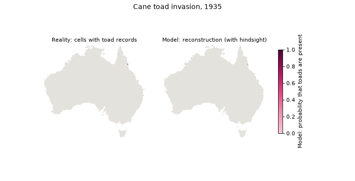

# Beyond the records: where invasive cane toads are, and where they are heading

Biodiversity records show where people looked, not where species live. This project separates the two to estimate where invasive cane toads (*Rhinella marina*) actually are in Australia, and tests the forecast against ten years of data the model had never seen.

**Read the report and explore the interactive map: [shalomilan.github.io/cane-toad-invasion](https://shalomilan.github.io/cane-toad-invasion/)**



*Left: reality, the 25-km cells with at least one toad record by each year. Right: the model, the probability that toads are present, recorded or not, from a single model fitted with all records up to 2025: a reconstruction with hindsight for 1935–2025 and the forecast from 2026. Its predictive skill was tested separately, on years it never saw (see validation below). Before 1990 the reconstruction is an extrapolation: the arrival and detection models are fitted on 1990–2025, and survey effort in the early decades was very low, so the early maps are the least reliable part of the figure.*

> Exploratory analysis, not peer-reviewed. All data are public and every number comes from the notebooks in this repository.

## Key results

- **For every two places where cane toads have been recorded, there is probably nearly one more where they live but nobody has recorded them.** Where few people look for frogs, toads can go unrecorded for a decade or more.
- **Toads occupy about 15% of Australia today, and will likely reach about 18% by 2035.** The invasion keeps growing, but more slowly as it reaches drier land.
- **Tested on ten years it had never seen, the model predicted better than one built on records alone.**

## Why records are not enough

A record needs two things: toads must be there, and someone must find and report them. The model separates both processes, following the logic of occupancy models with imperfect detection (MacKenzie et al. 2002, 2003):

- **Arrival:** every year, toads arrive in an empty cell with a probability that depends on the distance to occupied cells, occupied neighbours, climate suitability and region (the invasion moved 2–4 times faster outside Queensland).
- **Detection:** once there, toads are recorded with a probability that depends on survey effort, measured by records of other amphibians in the same cell and year.

The arrival year is never observed, so the likelihood sums over every possible arrival year. Uncertainty comes from 200 Monte Carlo simulations and a spatial block bootstrap of the coefficients.

## Notebooks

| # | Notebook | Question |
|---|---|---|
| 01 | [Download and EDA](notebooks/01_download_and_eda.ipynb) | What do the records say, and how biased are they? |
| 02 | [Invasion front](notebooks/02_invasion_front.ipynb) | First exploration: how fast did the invasion spread? (superseded by the area-based models below) |
| 03 | [Habitat suitability](notebooks/03_habitat_suitability.ipynb) | Where can toads live? (presence-background models, spatial block CV) |
| 04 | [Native range](notebooks/04_native_range.ipynb) | Is the climatic niche the same as in South America? |
| 05 | [Colonisation model](notebooks/05_colonisation_model.ipynb) | First model: where will new *records* appear? |
| 05b | [Desert limit](notebooks/05b_desert_limit.ipynb) | Does a hard desert limit improve the backtest? |
| 05c | [Why the west was too slow](notebooks/05c_west_speed.ipynb) | Regional rates and survey effort; why counts improved but probabilities did not |
| **05d** | [**Presence model**](notebooks/05d_presence_model.ipynb) | **Final model: arrival + detection, probability that toads are present** |
| 05e | [Reconstruction](notebooks/05e_reconstruction.ipynb) | Where were the toads each year since the release in 1935, using all records (with hindsight)? |
| 06 | [Reality vs model](notebooks/06_reality_vs_model.ipynb) | Builds the interactive report page and the GIF |
| 07 | [Model evaluation](notebooks/07_model_evaluation.ipynb) | Error by horizon, paired bootstrap, sensitivity, errors of each kind |

Notebooks 05–05c are kept on purpose: they document the path from a model of records to a model of presence, including what did not work.

Reusable code lives in [`src/`](src/): data downloads, front estimators, environmental grid, native range, the colonisation model and the arrival + detection model ([`occupancy.py`](src/occupancy.py)).

## How it was validated

Everything was refitted with data up to 2015 (and, separately, up to 2020) and the invasion was simulated to 2025. Against a model of records only, scored on the same cells, the log loss was 9–11% lower and the AUC 0.87 vs 0.83; a paired spatial block bootstrap shows the difference is not noise. One or two years ahead the simpler model is slightly better; from three years on this one wins by 3–11%. Details are on the [report page](https://shalomilan.github.io/cane-toad-invasion/#methods) and in notebook 07.

## Assumptions and limitations

- **Once toads arrive in a cell, they stay** (no local extinction). This may fail at the dry and cool margins: in occupied semi-arid cells toads are recorded 22% less often than expected, and on the cool southern front the range has shrunk in some decades (Macgregor et al. 2021).
- Long-distance jumps (probably toads carried by people) are underpredicted.
- Climate is static (1970–2000 normals) and future survey effort is assumed constant at its 2023–2025 level.
- The forecast in the arid west is an extrapolation: toads have not met that climate yet.
- The longest horizon validated is ten years, so the forecast stops at 2035.

## Reproduce

Requires Python 3.12 and [uv](https://docs.astral.sh/uv/).

```bash
uv sync
cp .env.example .env
```

Fill `.env` with the email registered at the [Atlas of Living Australia](https://www.ala.org.au) and a [GBIF](https://www.gbif.org) account (used for the native-range download). Then run the notebooks in order. Raw and processed data are not tracked: `src/download.py` downloads them on first use. The colonisation notebooks are slow (about 20–45 minutes each for 05, 05d and 07).

## Data

- Cane toad and amphibian records: [Atlas of Living Australia](https://www.ala.org.au).
- Native range: GBIF.org (12 October 2026) GBIF Occurrence Download, [doi:10.15468/dl.zh2ft4](https://doi.org/10.15468/dl.zh2ft4).
- Climate: [WorldClim 2.1](https://www.worldclim.org), 10 arc-minutes (Fick & Hijmans 2017).
- Rivers: [HydroRIVERS v1.0](https://www.hydrosheds.org/products/hydrorivers) (Lehner & Grill 2013).
- Artificial water (map layer only): Geoscience Australia, Surface Hydrology Points (National), CC BY 4.0.
- Photo on the report page: Bidgee, [Wikimedia Commons](https://commons.wikimedia.org/wiki/File:Young_Bufo_marinus.jpg), CC BY 3.0.

The full reference list is on the [report page](https://shalomilan.github.io/cane-toad-invasion/#references).

## Author

Ilán Shalom · [LinkedIn](https://www.linkedin.com/in/shalomilan/) · [ORCID](https://orcid.org/0009-0006-1309-4861)
